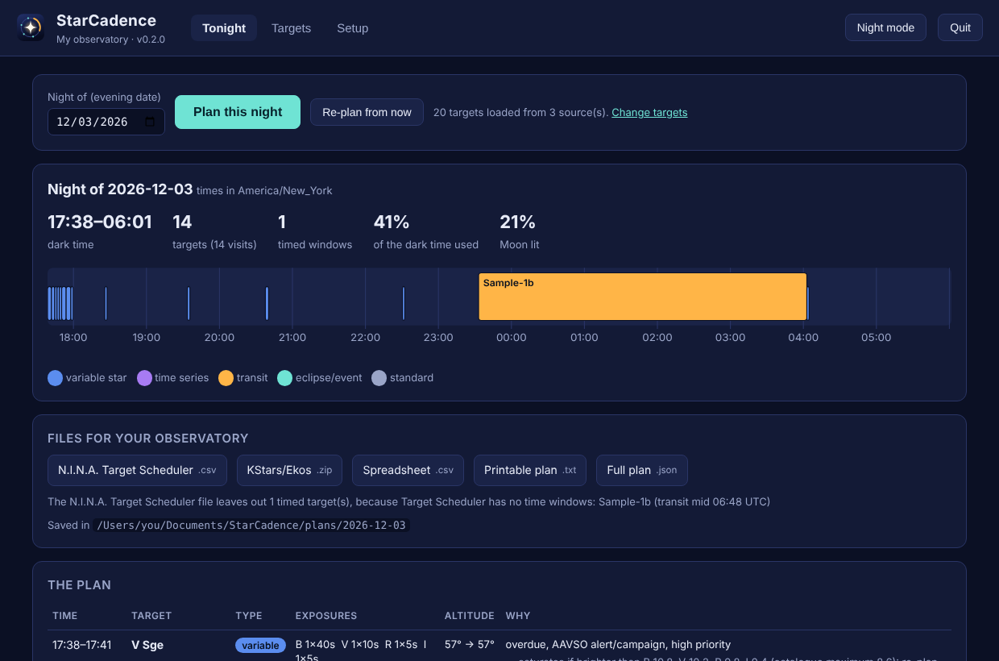
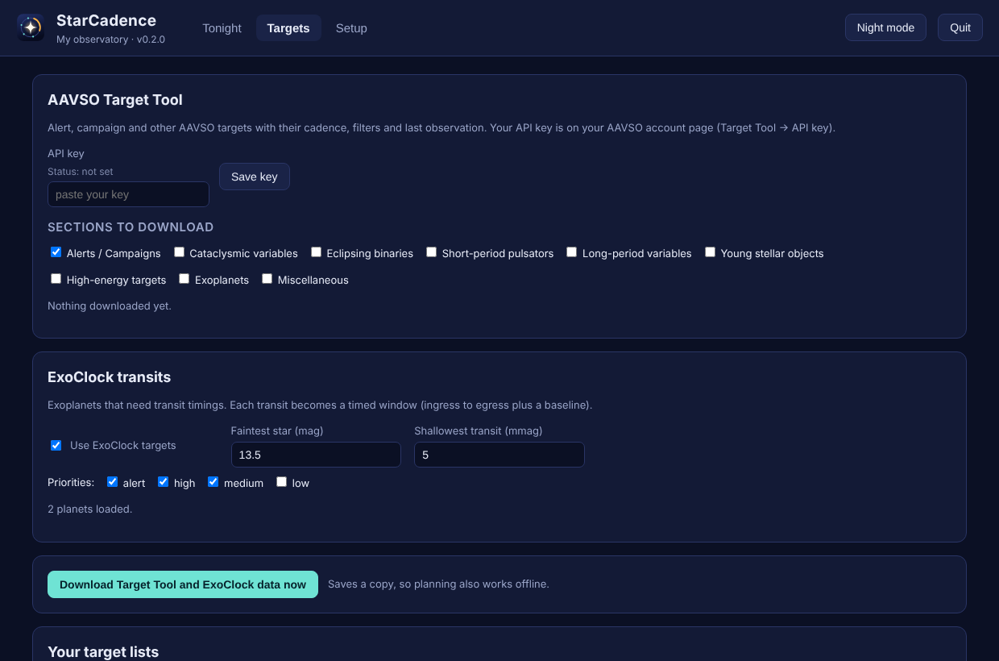
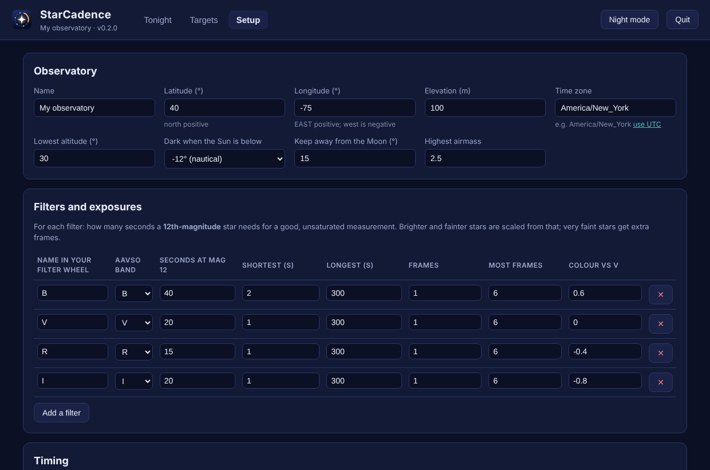

# StarCadence

[](https://github.com/TechAmatuer/StarCadence/actions/workflows/ci.yml)
[](https://ko-fi.com/techamatuer)
[](https://github.com/sponsors/TechAmatuer)

**StarCadence plans a whole night of variable-star and exoplanet-transit photometry for an automated observatory.
It runs on Windows, macOS and Linux.**

You tell it four things: where your observatory is, which filters you have, how long a 12th-magnitude star needs in
each filter, and where your targets come from (the AAVSO Target Tool, ExoClock, CSV lists, your own watch list).
For each night it works out:

- **which stars to observe, and in what order**: alert and campaign stars, stars that are overdue or get few
  observations, and stars that are about to set come first;
- **when**: transits and eclipse minima at their exact times, other stars when they are due, high enough and away from
  the Moon;
- **how**: which filters, how many seconds per exposure for that star's brightness, and how many frames.

It can then **run the night itself**: inside N.I.N.A. through the StarCadence plug-in (Windows), or directly over
INDI, the protocol KStars/Ekos observatories use (Mac, Linux, Windows). Either way it slews, sets the filter, takes
the exposures, records the visit, plans again, and goes on until dawn. It also writes the plan as text, CSV and JSON,
and as files for KStars/Ekos or N.I.N.A. Target Scheduler if you prefer to let those run it.

It does **not** process images or submit anything to the AAVSO. You measure the frames with your usual photometry
software and send the results.



## Download and open

1. Download the file for your computer from the
   **[latest release](https://github.com/TechAmatuer/StarCadence/releases/latest)**:
   `StarCadence-windows.zip` (Windows 10/11), `StarCadence-mac.zip` (Apple Silicon Mac) or
   `StarCadence-linux.tar.gz`. Nothing else needs installing.
2. Unzip it and double-click **StarCadence** (`StarCadence.exe` on Windows, `StarCadence.app` on a Mac).
   StarCadence opens in your web browser. It only answers this computer; nothing goes online except the
   AAVSO and ExoClock downloads you ask for.
3. The first time, enter your observatory and filters on the **Setup** tab, add targets on **Targets**,
   then press **Plan this night** on **Tonight**.

**First launch only.** StarCadence isn't signed with a paid Apple or Microsoft certificate, so each system asks once:
- **Windows:** "Windows protected your PC" → **More info** → **Run anyway**. A small black window stays open while
  StarCadence runs; close it to quit (but keep it open while a night is running).
  - If Windows says **Smart App Control** blocked it, there is no Run anyway button: Smart App Control blocks
    unsigned programs it doesn't know, with no exceptions. The only way is to turn it off (Windows Security → App & browser control → Smart App
    Control settings → Off); recent Windows updates let you turn it back on afterwards.
  - If StarCadence says Windows would not let it write to Documents, **Controlled folder access** is on: allow
    StarCadence.exe in Windows Security → Virus & threat protection → Ransomware protection.
- **Mac:** if it says StarCadence "can't be opened", open **System Settings → Privacy & Security**, scroll down and
  click **Open Anyway** (or in Terminal: `xattr -dr com.apple.quarantine ~/Downloads/StarCadence`). StarCadence
  has no Dock icon; it runs in your browser. It may ask to use your Documents folder, where it keeps your settings
  and plans (`Documents/StarCadence`).

To quit, press **Quit** in the page, or just close the tab: StarCadence stops a few minutes later. Opening it again
keeps everything.

## Why

Observers with automated observatories still pick targets by hand: which alert or campaign stars need data, which are
overdue, which time-series and transit windows fit tonight, and what exposure each star needs in each filter.
With tens of targets and four filters, that is an hour of work every day. StarCadence does it in about a second, and
says why it chose each star and why it left others out.

## What a plan looks like

From [`examples/sample-output/plan.txt`](examples/sample-output/plan.txt) (sample site and targets, night of 3 December 2026):

```
Night of 2026-12-03 at My observatory  (times America/New_York)
Dark from 17:38 to 06:01; Moon 21% lit
14 blocks, 14 targets from 17 candidates; 41% of the dark time used

17:38-17:41  V Sge                  Variable  alt 57->57  B 1x40s  V 1x10s  R 1x5s  I 1x5s
      score 3.30 (Cadence 1.00, Alert 0.70, Priority 1.00)
      - saturates if brighter than B 10.8, V 10.2, R 9.8, I 9.4 (catalogue maximum 8.6): re-plan after an outburst alert
      - AAVSO alert or campaign target
17:41-17:44  SS Cyg                 Variable  alt 80->80  B 1x40s  V 1x12s
      score 3.23 (Cadence 0.99, Alert 0.70, Priority 1.00)
...
23:33-04:02  Sample-1b              Transit  [fixed]  alt 81->48  R 1463x8s
      score 1.85 (Priority 0.80, LowCoverage 0.75, Slew 1.00); transit mid 06:48 UTC
      - ExoClock priority high, depth 18 mmag

Not planned (3):
  T CrB: not observable tonight (too low)
  Sample-2b: transit mid 10:40 UTC: window runs outside dark time
```

## The four main features

### 1. Time windows
- **Transits** (from ExoClock or your list): it predicts every transit in the night from the epoch and period. Each
  window runs from ingress minus a baseline to egress plus a baseline (60 minutes by default). The window is widened by
  the ephemeris uncertainty for that date, and the BJD time is converted to UTC.
- **Eclipse minima and other periodic events**: give an epoch and a period (and a phase, if it isn't the primary
  minimum); it finds each event in the night.
- **Your own windows**: any target can have time windows. A *fixed* window must be covered start to end; an ordinary
  one only limits when the star may be observed. Campaign start and end dates are honoured too.
- A fixed window is planned only if the target is observable for all of it. When two fixed windows clash, the
  higher-scoring one is kept and the other is reported.

### 2. Repeat cadence
- Each star has a cadence in days (from the Target Tool, your list, or a default). It is due again once 80% of the
  cadence has passed since your last visit.
- A cadence under a day means several visits in one night. For example, 0.1 days gives a visit about every 2.4 hours
  while the star is up.
- Your visits are kept in `history.json`. Mark a night done with `starcadence record`, so stars are not repeated too soon.

### 3. Target sources
- **AAVSO Target Tool**, through its API with your own key, or a CSV exported from its website. It reads alerts and
  campaigns, cadence, filters, priority, last data point, time-series requests and solar conjunction. Stars that want
  only spectroscopy are skipped.
- **ExoClock** transit planets, filtered by priority, brightness and depth.
- **Any CSV list** with Name, RA and Dec columns, in any order. The column names used by the N.I.N.A. ExoPlanets
  plug-in all work, and so do spreadsheets saved in decimal-comma languages (semicolon columns, `12,5`).
- **Watch list** in the configuration, for stars you always want.
- The same star from several lists or rows is merged into one target. It keeps the highest priority, the shortest
  cadence and every filter asked for.

### 4. Exposure per star brightness and filter
- Each filter has a reference exposure for a magnitude-12 star. A star of magnitude *m* gets
  `refExposure x 10^(0.4 (m - 12))`, rounded to a familiar value and kept between your shortest and longest exposure.
- A star too faint for the longest exposure gets extra frames, up to a limit you set.
- A star with no magnitude in a filter's band uses its V magnitude plus a typical colour offset for that filter.
- If a star's catalogue maximum would saturate at the planned exposure (a dwarf nova in outburst, say), the plan
  says at what magnitude each filter saturates. You can also make it shorten exposures for the bright limit
  (`planner.capForBrightLimit`).
- A filter that isn't in your wheel is replaced by the nearest one (Sloan r by R, for example), and the plan says so.
- **In N.I.N.A., the exposure can be measured instead.** Tick **Measure exposure** on the StarCadence Night instruction:
  once a night for each target and filter, after centring, StarCadence takes a short test frame, finds the target star
  at the centre, and sets the exposure so its peak lands at the share of the camera's range you choose (60% by
  default), as the ExoPlanets plug-in's *Calculate Exposure Time* does. Saturated tests are retried shorter, faint
  ones longer.

## How it decides

1. Fixed windows (transits, minima) go in first, best score first, with no overlaps.
2. The gaps are filled one visit at a time. At each moment it takes the highest-scoring star that is due, inside its
   windows and dates, and observable for its whole visit. The visit includes the slew, filter changes, exposures and
   readouts.
3. The score adds up weighted rules (the same design as N.I.N.A. Target Scheduler). Every weight can be changed in
   `planner.ruleWeights`:

| Rule | Prefers |
|---|---|
| Priority | targets marked high priority (Target Tool, ExoClock, watch list) |
| Cadence | stars overdue for their cadence (up to 6 cadences late) |
| LowCoverage | stars with few recent observations |
| Alert | AAVSO alert and campaign targets |
| SettingSoonest | targets about to set |
| Deadline | campaigns about to end |
| Slew | short slews from the last target |
| Altitude | higher in the sky |
| Efficiency | short visits, so more stars fit |

Running the planner again during the night (`--from now`) plans the rest of the night: after clouds, a fault, or a
new alert.

## Running the night

Three ways, from least to most automatic:

| Your setup | What to do | Plate solving, focus, guiding |
|---|---|---|
| **N.I.N.A. 3.2 or newer** (Windows) | Install the **StarCadence plug-in** (`StarCadence-nina-plugin.zip` from the release page; see [its README](src/StarCadence.Nina/README-NINA.md)) and add the **StarCadence Night** instruction to your sequence. It plans, slews, centres, exposes and re-plans inside N.I.N.A. | N.I.N.A.'s own: plate-solve centring on each target, and your triggers (Meridian Flip, Autofocus, Dither, Center After Drift) fire between its steps. Drop extra steps into its **Before each target** and **After each target** areas. |
| **KStars/Ekos or any INDI server** (Mac, Linux, Windows, Raspberry Pi) | On the Tonight tab, **Run the night → Through an INDI server**, enter `host:port` (Ekos's INDI server is usually `localhost:7624`), press Start. Or `starcadence run --indi host:port`. | None yet: it slews, changes filters and exposes; focus first, and use a mount that points well. For plate-solve centring, export the Ekos files instead and let Ekos run them. |
| **Rehearsal** (no hardware) | **Run the night → Simulation**, pick a speed, press Start. Or `starcadence run --simulate --from 2026-12-04T02:00:00Z --speed 600`. | Shows exactly what a night would do, in minutes. |

During a run the window shows the phase, the current and next target, the exposure count and a live log; **Stop**
finishes the current exposure and parks the mount. While a night runs, the computer is kept from going to sleep
(the screen may still turn off). Each visit is written to `history.json` as it starts, so a
re-plan (or tomorrow's plan) knows what has been done. Frames from an INDI run are saved under
`images/<night>/` as FITS with `OBJECT`, `FILTER`, `RA` and `DEC` cards added.

## Compared with Target Scheduler and ExoPlanets

StarCadence started as a way to get what two N.I.N.A. plug-ins do, together, for photometry: Target Scheduler's
automatic, re-planned night and ExoPlanets' transit timing and exposure calculation. Today you have to pick one: the
ExoPlanets exposure tool can't run inside a Target Scheduler night.

| | Target Scheduler | ExoPlanets | StarCadence |
|---|---|---|---|
| Picks the next target itself and re-plans after each | yes | no, one target per container | yes |
| Uses N.I.N.A.'s own slew/centre, filter and exposure steps | yes | yes | yes |
| Your triggers fire (Meridian Flip, Autofocus, Dither, Center After Drift) | yes | yes | yes |
| Your own steps before/after each target | yes (7 slots) | in its container | yes (before and after each target) |
| Stops tracking, or parks, while waiting | yes | no | yes |
| Horizon, minimum altitude, Moon distance | yes, Moon avoidance per filter | N.I.N.A.'s horizon ("above horizon" filter for its target list) | yes, one Moon distance for all filters; N.I.N.A.'s horizon is used if StarCadence has none |
| Transit and eclipse-minimum time windows | no | yes (waits for the transit) | yes |
| Repeat cadence (every N days) | no (it collects a total) | no | yes |
| Targets from AAVSO Target Tool, ExoClock, lists | CSV import | ExoClock, Swarthmore, AAVSO CSV | Target Tool, ExoClock, any CSV, watch list |
| Exposure from the star's magnitude | no | no | yes |
| Exposure measured from a test frame | no | yes | yes (optional) |
| Comparison-star chart and star list for Siril | no | yes | no |
| Image grading, flats per target, mosaics, several telescopes | yes | no | no |
| Mac and Linux (INDI, Ekos) | no | no | yes |

ExoPlanets finds the target in its test frame by plate-solving it; StarCadence measures the brightest star near the
centre right after N.I.N.A.'s centring, which can only make the exposure shorter if a brighter star is close by.

## The app window

| Tonight | Targets | Setup |
|---|---|---|
|  |  |  |

- **Tonight:** pick the night, press *Plan this night* (or *Re-plan from now* after clouds or a new alert). You get a
  timeline, the plan with the reasons for each star, and download buttons for N.I.N.A., Ekos and a spreadsheet.
  After the night, *Mark finished visits as observed* keeps the repeat cadence right.
- **Targets:** your AAVSO Target Tool key and sections, ExoClock settings, a *Download now* button, your CSV lists
  (drop in a Target Tool export or an ExoPlanets list) and the watch list.
- **Setup:** observatory position, darkness and Moon limits, filters with their exposure at magnitude 12, timing,
  and (advanced) the scoring weights.
- **Night mode** turns the page red for use at the telescope.

## Outputs

| File | For |
|---|---|
| `plan.txt` | reading: times, filters, exposures, reasons |
| `plan.csv` | a spreadsheet: one row per filter step |
| `plan.json` | other programs (the full plan) |
| `ekos/plan.esl` + `.esq` files | **KStars/Ekos** (macOS, Linux, Windows). Transits and minima start and stop at their times; other jobs run in plan order. |
| `nina-target-scheduler.csv` | **N.I.N.A. Target Scheduler** bulk import (Windows), one row per target, typed by exposure length so each type maps to an exposure template. Target Scheduler has no time windows, so transits and minima are left out and listed on screen. The StarCadence plug-in (above) has no such limit. |

## Running from source (command line)

The app window is the easy way. The command line does the same, for scheduled or automatic runs.

**1. Install the .NET SDK (version 8 or newer), once.**

Mac (Terminal):
```bash
brew install --cask dotnet-sdk          # or the installer from https://dotnet.microsoft.com/download
```
Windows (PowerShell):
```powershell
winget install Microsoft.DotNet.SDK.8   # or the installer from https://dotnet.microsoft.com/download
```

**2. Get StarCadence and try the example night.**
```bash
git clone https://github.com/TechAmatuer/StarCadence.git
cd StarCadence
dotnet run --project src/StarCadence.Cli -c Release -- plan --config examples/config.json --date 2026-12-03 --out my-test
```

**3. Make your own configuration.**
```bash
dotnet run --project src/StarCadence.Cli -c Release -- init --dir my-observatory
```
Edit `my-observatory/config.json`: your site's latitude, longitude (east positive) and time zone, your filters and
reference exposures, and your sources. Then:
```bash
dotnet run --project src/StarCadence.Cli -c Release -- plan --config my-observatory/config.json --formats txt,csv,ekos,nina
```

To open the app window from source: `dotnet run --project src/StarCadence.Cli -c Release` (no arguments).

## Commands

```
starcadence                                            open the app window (settings in Documents/StarCadence)
starcadence app       [--data FOLDER] [--port N] [--no-browser] [--stay]
starcadence init      [--dir FOLDER]                   write an example config.json to edit
starcadence fetch     [--config FILE]                  download AAVSO Target Tool and ExoClock data
starcadence plan      [--config FILE] [--date YYYY-MM-DD] [--from now|TIME]
                      [--out FOLDER] [--formats txt,json,csv,ekos,nina] [--fetch]
starcadence run       [--config FILE] --indi [HOST[:PORT]] [--no-park]       run tonight through an INDI server
starcadence run       [--config FILE] --simulate [--from TIME --speed N]   rehearse tonight with no hardware
starcadence record    [--config FILE] --target NAME [--utc TIME]
                      or --plan plan.json [--until TIME]   mark visits done (drives the cadence)
starcadence exposures [--config FILE] --mag M [--bright M]  exposure per filter for one star
starcadence ephem     [--config FILE] --utc TIME [--ra RA --dec DEC]   Sun, Moon and target positions
```

Without `--date`, `plan` plans tonight (or the night in progress). Times are UTC, written like `2026-12-04T03:00:00Z`.
RA can be `05 34 31.9`, `05:34:31.9` or decimal degrees (use a column named `RA_h` for decimal hours).

### Your AAVSO Target Tool key

StarCadence never stores the key. Put it in an environment variable before `fetch`:
```bash
export AAVSO_TARGETTOOL_KEY="your key"     # Mac/Linux
$env:AAVSO_TARGETTOOL_KEY = "your key"     # Windows PowerShell
```
Without a key, export a CSV from the Target Tool website and set `sources.targetToolCsv`.

## Accuracy and testing

- **Positions** of the Sun, Moon and stars use Meeus's algorithms. Checked against astropy at 40 random times:
  altitudes within 0.013°, Moon separation within 0.006°, Moon illumination within 0.002.
- **Dark-time limits** fall where the Sun really is at the limit altitude (within 0.005°).
- **Transit and minimum times** convert BJD/HJD to UTC within 6 seconds.
- **54 automated tests** check the planner's rules (no overlaps, every block observable, windows kept, cadence
  spacing), the sources and exporters, and the **night runner**: a whole night against a fake observatory, transits
  started and stopped on time, failed targets retried later, unsafe weather pausing the night, clean stops, a history
  file that is locked or unwritable, keeping the computer awake, the steps before and after each target, the waits, and the
  exposure meter on synthetic stars (noise, hot pixels, saturation, a brighter neighbour). GitHub Actions runs them on Windows, macOS (Apple
  Silicon) and Linux on every change (badge at the top), and on Windows again under Portuguese, German, Thai and
  Turkish number and date formats. It starts the packaged program's app window on all three systems, drives it in a
  real browser on Linux, and runs a night through a **real INDI server** with simulated mount, filter wheel and
  camera, checking the saved FITS files.
- **The N.I.N.A. plug-in** is built on GitHub's Windows machines against N.I.N.A.'s plug-in library 3.2, checked the
  way N.I.N.A.'s plug-in loader sees it (exports, metadata, templates), packaged the way N.I.N.A.'s installer unpacks
  plug-ins, and its manifest is made with N.I.N.A.'s own tool and validated against N.I.N.A.'s schema. Whole nights are
  then run inside N.I.N.A.'s own sequencer classes with stand-in equipment: triggers placed on the instruction and above
  it fire between steps and see the current target, the before/after-target steps run at the right moments, waits stop
  tracking or park, measured exposures are used, and stopping the sequence stops the night and parks.
- **The app window** only listens on this computer (127.0.0.1); every change needs a key that only its own page
  has, so other web pages can't use it.
- **File formats**: Ekos files follow the KStars source; the Target Scheduler CSV is read back the way its importer
  reads it.

**Not yet tested:** the plug-in inside a live N.I.N.A. session (it is compiled and checked, not yet run with real
or simulated N.I.N.A. equipment); an INDI run against real hardware (only the simulator drivers so far); loading the
Ekos files into a live Ekos; live Target Tool and ExoClock downloads; the Windows and Mac downloads on real (non-CI)
machines. Please open an issue if something doesn't work.

## Known limits

- Meridian flips are not modelled in the plan; N.I.N.A.'s Meridian Flip trigger (or your mount software) does the flip during a visit.
- Exposures come from the magnitude you give (or the middle of the catalogue range). Give current magnitudes for
  large-amplitude stars (Miras, novae) or the exposure can be far off.
- The INDI runner does not plate-solve, focus or guide. It is right for short photometric exposures on a mount that
  points well, after focusing; otherwise let Ekos run the exported files.
- In N.I.N.A., StarCadence does not grade images, take flats per target, or make comparison-star lists; use N.I.N.A.'s
  own flat instructions (in **After each target** or at the end of the night) and your photometry software for the rest.

## Project layout

| Folder | What |
|---|---|
| `src/StarCadence.Core` | the planner, sources, exporters, night runner and INDI client (Windows, macOS, Linux) |
| `src/StarCadence.Cli` | the program: app window and command line |
| `src/StarCadence.Nina` | the N.I.N.A. plug-in (Windows only) |
| `tests/` | the test suite, the browser test, the plug-in checks |
| `examples/` | a sample configuration, target list and finished plan |

## Support StarCadence

StarCadence is free and open source, and stays that way. If it saves you time at the telescope, you can support its
development:

- **[Ko-fi](https://ko-fi.com/techamatuer)**: a one-off tip or monthly support by card or PayPal, no account needed.
- **[GitHub Sponsors](https://github.com/sponsors/TechAmatuer)**: monthly or one-time, from your GitHub account.

Telling other observers about it, starring the repository and [reporting problems](https://github.com/TechAmatuer/StarCadence/issues)
help too.

## Licence and credits

[MPL-2.0](LICENSE.txt). StarCadence reuses ideas and code from the N.I.N.A. **Target Scheduler** plug-in (scoring
rules) and the **ExoPlanets** plug-in (event windows, CSV formats, ExoClock fields), both MPL-2.0. See
[NOTICE.md](NOTICE.md).
